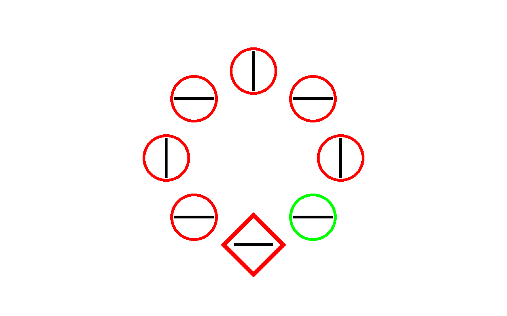
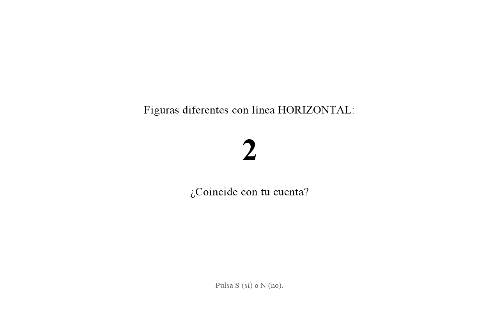

# Counting on Suppression: experimental task

This folder contains the experimental task of the registered report **"Counting on Suppression: Does Learning to Ignore Distractors Depend on Executive Resources? A Registered Report"**. It is a visual search task (*additional singleton* paradigm) with a concurrent counting task, written in [PsychoPy](https://www.psychopy.org/). The search task is translated from the original program of Vicente-Conesa et al. (2023), available on [OSF](https://osf.io/c23pk/files/osfstorage/6aeb0cb2132ef5887df441c8).

<table>
  <tr>
    <td align="center" width="50%"><br>
      <sub>Example search display</sub></td>
    <td align="center" width="50%"><br>
      <sub>Example secondary task (Spanish)</sub></td>
  </tr>
</table>

## Quick start

1. **Download** the repository (*Code → Download ZIP*, then unzip it) or clone it with git, and open the folder `Materials/psychopy_task`.
2. **Set up the lab monitor.** Open `task/init.py` and fill in the screen width (cm), viewing distance (cm) and resolution under `MONITOR_*`.
3. **Run a participant.** Double-click `run_task.bat`.
   - A form asks for the participant number, age, gender and dominant hand.
   - The task then starts in full screen, and the instructions guide the participant from there.
   - Press `Esc` to quit at any time; the data saved up to that point are kept.
4. **Collect the data.** Each session is saved in `data/ast_<participant>_<date>.csv`.

### What `run_task.bat` does

The launcher makes the task run with the same software on every computer (Windows):

- If **PsychoPy 2026.1.1** (Standalone) is installed, it uses it.
- Otherwise, it installs [uv](https://docs.astral.sh/uv/) (no administrator rights needed) and runs the task in an isolated Python 3.10 environment with the package versions in `requirements.txt`.
  - The first time, this needs internet and takes a few minutes; later runs start at once.
  - Nothing else on the computer changes.

`run_task.bat test` runs a short automatic session (no participant needed) to check the installation.

On macOS or Linux, install PsychoPy 2026.1.1, or run `uv run --no-project --python 3.10 --with-requirements requirements.txt main.py` in the task folder. You can also open `main.py` in PsychoPy Coder and press *Run*.

## Settings

Everything that can be adjusted is in `task/init.py`:

| Setting | What it does |
|---|---|
| `GROUP` | `"load"`: the task of this study (counting task, 3-s response window). `"control"`: the original task of Vicente-Conesa et al. (2023). |
| `MONITOR_*` | screen width and viewing distance (cm), resolution |
| `SIZE_UNITS`, `ORIGINAL_*` | sizes are defined in the pixels of the original program. With `"deg"`, they are converted to degrees of visual angle from the geometry of the original lab. |
| `FIXATION_S`, `ITI_S`, `FEEDBACK_S`, `RESPONSE_WINDOW_S` | timing (s) |
| `N_BLOCKS`, `N_PER_CONDITION`, `PERIOD_LENGTHS`, `N_PRACTICE` | design |
| `KEY_FOR`, `VERIFY_KEYS` | response keys |

All texts shown to participants (in Spanish) are in `task/text.py`.

## Data

One CSV per session, in long format: one row per search trial, count verification, comprehension question and attempt of the awareness test, with the type of row in `phase`. Every row is written as soon as it is complete.

| `phase` | Main columns |
|---|---|
| `practice`, `experimental` | `block`, `trial_in_block`, `condition` (ND/HPDL/LPDL), `target_pos`, `distractor_pos` (0 = none), `design`, `target_orientation`, `response_key`, `correct`, `timed_out`, `rt_ms`, and the period of the counting task (`period`, `count_orientation`, `counted_target`) |
| `practice_verification`, `verification` | `true_count`, `shown_count`, `shown_is_correct`, `verify_key`, `verify_correct`, `verify_rt_ms` |
| `quiz_search`, `quiz_count` | `quiz_attempt`, `quiz_question`, `quiz_answer`, `quiz_correct` |
| `awareness` | `aware_r1` (1–6 rating), `aware_r2` (chosen location, 1–8), `aware_repeat` |

Every row also carries the session information: participant, group, date, random seed, high-probability location, demographics and settings.

Locations are numbered 1–8 clockwise from 9 o'clock. Conditions and designs keep the codes of the original program.

## Folder structure

```
run_task.bat       launcher (Windows): finds or sets up PsychoPy and runs the task
main.py            entry point: start form and session
requirements.txt   package versions (Python 3.10)
task/init.py       settings
task/helper.py     stimuli, trial lists, window, search display
task/text.py       texts shown to participants
task/experiment.py the session: instructions, practice, blocks, counting task, awareness test, data
docs/              images for this README
data/              output (not tracked)
```

## Reference

- Vicente-Conesa, F., Giménez-Fernández, T., Luque, D., & Vadillo, M. A. (2023). Learning to suppress a distractor may not be unconscious. *Attention, Perception, & Psychophysics*. https://doi.org/10.3758/s13414-022-02608-x
